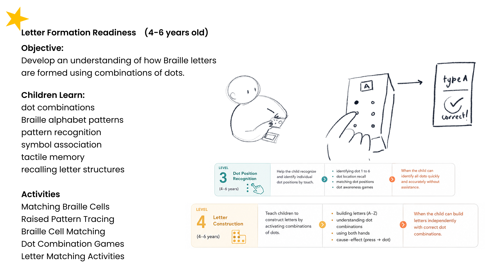
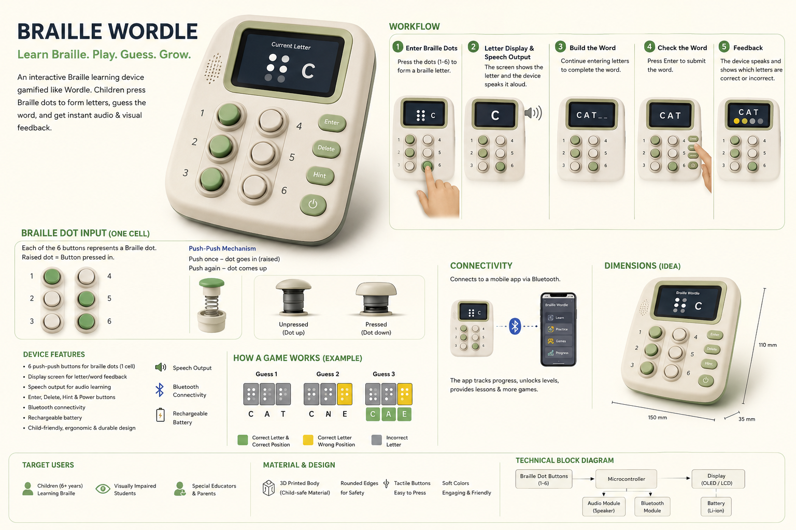
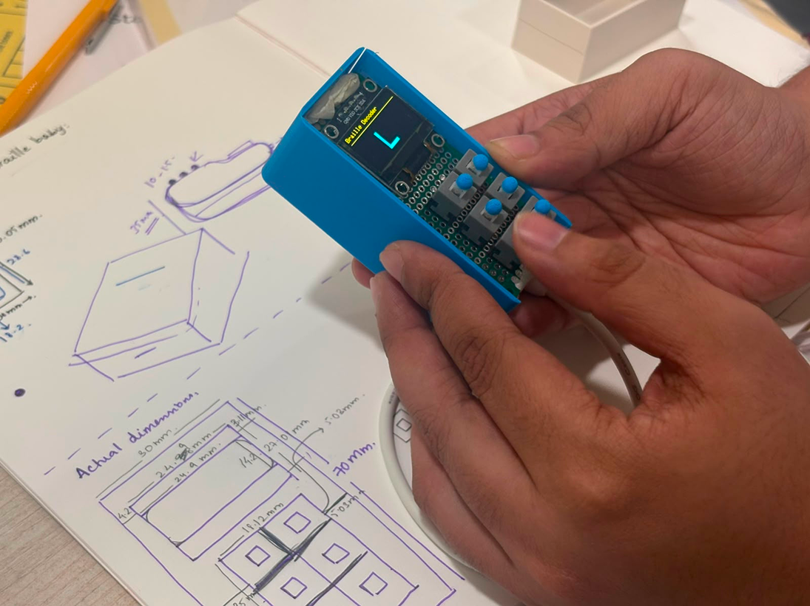

# Braill-o

**A playful way to explore and learn Braille, one dot at a time.**

Braill-o is a hands-on Braille learning device built around the idea of learning through play. The concept originated from **Braille Wordle** — inspired by word-guessing games like Wordle, with a similar element of challenge and discovery applied to learning Braille.

The device uses six tactile switches to represent the six dots of a Braille cell. Users can enter dot combinations, view the corresponding characters on an OLED display, and receive audio feedback.

## The Idea

Understanding the need for a more interactive approach to Braille learning was the starting point of this project.

  

The initial device concept was explored through an AI-generated proof-of-concept visual before moving towards the physical prototype.

  

  Early AI-generated concept visual; for ideation purposes only.

## The Prototype

  

## Hardware & Software

| Component | Details |
|---|---|
| Microcontroller | Raspberry Pi Pico (RP2040) |
| Braille Input | 6 tactile switches |
| Display | OLED (I2C) |
| Audio | DFPlayer Mini and speaker |
| Enclosure | 3D-printed |
| Development Environment | Arduino IDE |
| Board Support | Earle Philhower RP2040 Arduino Core |
| Libraries | Adafruit GFX, Adafruit SSD1306, DFPlayer library |
| Programming Language | C++ |

## Firmware

The repository contains different stages of firmware development:

| Folder | Description |
|---|---|
| `braille_decoder` | Initial Braille character decoder |
| `braille_decoder_oled` | Decoder with OLED display |
| `braille_decoder_oled_dfplayer` | Integration of audio feedback |

---

*An ongoing exploration of making Braille learning more interactive, accessible, and engaging.*